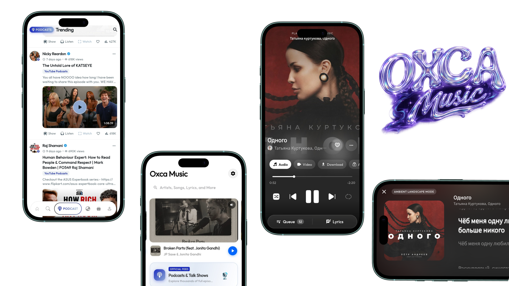

# 🎵 OXCA Music – Ultimate Music Experience

  

  
  
  

<h3 align="center">🚀 Your Music. Your World. Your Experience.</h3>

  A powerful, modern music application designed to bring music streaming, downloads, playlists, lyrics and video playback together.

  ⭐ If you love OXCA Music, support us with a GitHub star!

---

## 🌌 About OXCA Music

**OXCA Music (Oxcamusic)** is a modern Android music application built with Flutter to deliver a smooth, fast and feature-rich music experience.

Discover music, stream your favorite tracks, manage playlists, enjoy video playback, explore lyrics and experience a beautifully designed music player.

OXCA Music combines powerful functionality with a premium interface to make music more enjoyable.

## 📥 Download OXCA Music – Start Listening Today!

Ready to experience music in a whole new way? 🎧

Download **OXCA Music** directly from Google Play and enjoy powerful music features, smooth playback, playlists, lyrics, video streaming and much more.

  

  <b>🚀 Get OXCA Music Today. Your Ultimate Music Experience Awaits!</b>

  🌐 <a href="https://www.oxcamusic.t-rex.site">Official Website</a> |
  ✈️ <a href="https://t.me/oxcamusic">Telegram Community</a>

## ✨ Features

| Feature | Description |
|---|---|
| 🎧 Music Streaming | Enjoy your favorite music |
| 📥 Music Downloads | Download supported audio content |
| 🎬 Video Player | Enjoy MP4 video playback |
| 🎼 Lyrics | Discover song lyrics |
| 📻 Radio | Radio listening experience |
| 🔍 Smart Search | Find songs and artists |
| 🎵 Playlists | Create and manage playlists |
| ⚡ Fast Playback | Smooth and responsive playback |
| 🎨 Premium UI | Modern glassmorphism-inspired interface |
| ☁️ OXCA Cloud | Cloud backup functionality |
| 🎶 Queue Management | Organize upcoming tracks |
| 🔊 Spatial Audio | Enhanced audio experience |
| 📊 Music Charts | Explore popular music |
| 🎤 Music Recognition | Discover songs through recognition |

## 🚀 Why Choose OXCA Music?

- Modern and intuitive user interface.
- Built using Flutter and Dart.
- Smooth music playback experience.
- Powerful music discovery features.
- Music and video functionality in one app.
- Continuous improvements and updates.
- Designed for Android users.

## 🛠️ Technology Stack

  

- **Framework:** Flutter
- **Programming Language:** Dart
- **Audio Engine:** Just Audio
- **Background Playback:** Audio Service
- **Lyrics Integration:** LRCLIB
- **Version Control:** Git & GitHub

## 🌍 Official Links & Community

Stay connected with OXCA Music and receive the latest announcements, updates and releases.

- 🌐 **Website:** https://www.oxcamusic.t-rex.site
- 📱 **Google Play:** https://play.google.com/store/apps/details?id=in.oxca.music
- ✈️ **Telegram:** https://t.me/oxcamusic
- 💻 **GitHub:** https://github.com/asabijith/oxca4kmax

## ⭐ Support OXCA Music

OXCA Music is continuously evolving. Your support helps the project grow and reach more music lovers.

If you enjoy the project:

1. ⭐ **Star this repository** – Help more people discover OXCA Music.
2. 🔄 **Share the project** – Tell your friends and developer community.
3. 🐛 **Report bugs** – Help improve the application.
4. 💡 **Suggest features** – Share ideas for future releases.
5. 📢 **Join Telegram** – Stay updated with new versions.

  
  
  

## 📜 Disclaimer

OXCA Music is a music application. Users are responsible for ensuring their use of third-party content complies with applicable copyright laws and platform terms. OXCA Music does not claim ownership of third-party content.

---

<h2 align="center">🎵 OXCA MUSIC</h2>

  <b>Ultimate Music Experience.</b>
   
  Built with ❤️ using Flutter.

  

  ⭐ STAR THE REPOSITORY AND SUPPORT OXCA MUSIC! ⭐

